# Architecture

## In one paragraph

A plain-Python **Runtime** (asyncio) owns the hardware adapters, the perception plugins, the
scheduler and the reminder state machine. It publishes typed **events** to an in-process bus that
feeds the dashboard and a SQLite research log. The **CLI** (`pasr …`) and the **Streamlit
dashboard** both drive it. The dashboard keeps one runtime alive on a background thread
(`RuntimeHandle`); data-only commands write SQLite directly, and the running scheduler picks the
changes up by polling. Every device and every algorithm is a **Protocol**, and the product
code contains only real implementations. The tests swap in stand-ins (`tests/support/`: a
scripted room, devices that act on it, perception plugins, a virtual clock), so a 7-minute
reminder flow runs in milliseconds without the robot.

## Module map (`src/pasr/`)

| Package | Responsibility | Depends on |
|---|---|---|
| `domain/` | Pure logic: enums, models, identity matching, **disclosure policy**, timing, threshold calibration maths, face framing for following a face. No I/O. | numpy |
| `settings/` | Settings schema with Basic/Advanced tiers; layered loading. | domain, perception.registry |
| `perception/` | Plugin registry + protocols; InsightFace, SpeechBrain ECAPA, Resemblyzer, Silero, faster-whisper and zero-shot sensitivity plugins (lazy-loading, `lazy.py`); energy VAD, keyword sensitivity and dateparser baselines; speech segmenter; model weights (`models.py`). | domain, settings.tiers |
| `hardware/` | Device protocols (head, speaker, camera, microphone, watch); adapters (Ohbot via one locked `ohbot_driver.py`, macOS `say`, bleak BLE, OpenCV, sounddevice, speaker output device); WAV-file and image-folder research sources; Bangle wire protocol; device discovery and checks (`discovery.py`, `check.py`). | domain |
| `storage/` | SQLite schema, migrations, repositories, reset. | domain |
| `live/` | The live view (off by default): `feed.py` keeps the latest frame, audio levels and match labels of the listening, scanning, enrolment and calibration steps in memory; `desktop.py` sends them to the window (`window.py`, a separate process) over a pipe (`wire.py`). | domain |
| `orchestration/` | Clocks, event bus, FSM, scheduler, runtime lock, enrolment (with progress), threshold calibration, `Runtime`, `RuntimeHandle`. | everything above |
| `apps/` | Robot apps. `reminder/`: service, voice capture, **due flow**, scheduler-driven app, CLI. | orchestration |
| `dashboard/` | Streamlit pages (overview, devices, events, setup, reminders, people, calibration, settings, reset) and the schema-driven settings form. | everything |
| `cli.py` | `pasr` command (typer). | everything |

## Concurrency

- One asyncio loop per runtime. In the dashboard it runs on the `pasr-runtime` thread; Streamlit
  scripts reach it only through `RuntimeHandle.call/call_sync/snapshot` and never share objects.
- Blocking perception work (ML inference) goes through `RobotContext.compute`, which uses a
  thread pool (or inline with `Runtime(inline_compute=True)`, which tests on a virtual clock
  use to stay deterministic). Hardware adapters run their blocking library calls with
  `asyncio.to_thread`.
- The `ohbot` library is not thread-safe and has import-time side effects, so one `OhbotDriver`
  per process imports it (after switching to `.ohbot/`) and serialises every call with a lock;
  the head and the speaker share it, so lip-sync moves never interleave with scan moves.
- ML plugins construct cheaply and load their model on first use under their own lock, so
  listing or configuring them never imports torch or onnxruntime.
- The live view (`live_view.enabled`): the flows update `LiveFeed` on the runtime's loop, each
  update replacing an immutable `LiveView`. In the runtimes of the dashboard and the terminal
  commands (`Runtime(live_window=True)`), `DesktopWindow`, a task on the loop, sends each new
  view to a separate window process, `python -m pasr.live.window`: macOS opens windows only on
  a main thread, the dashboard's runtime runs on a background thread, and an in-process window
  would stall the loop while it is dragged. A feeder thread writes to the window's stdin and
  drops the oldest messages when it falls behind.
- The webcam runs in a helper process too, `python -m pasr.hardware.camera.helper` (ADR 0010):
  a camera that drops off USB and comes back stays dead in a process that had it open, so a
  stalled camera is reconnected by starting a fresh helper. Each helper finds the head camera
  by name (`hardware.camera.name`, `C615`), not by OpenCV index: indices shift as an iPhone
  comes and goes, and with the head camera unplugged index 0 is the laptop's own camera.
- While the runtime runs, `Notices` (`orchestration/notices.py`) turns every warning and error
  the robot logs, and any error nothing caught on its loop, into an in-memory notice; the
  dashboard's `alerts` fragment shows each once as a toast on any page, with the failed
  pipelines.
- `data/.runtime.lock` (filelock) allows **one runtime per data directory**. It owns the robot,
  camera, microphone and watch, and runs the scheduler, so a reminder is never delivered twice.

## The reminder-due state machine

`apps/reminder/due_flow.py` , transitions are a table (`TRANSITIONS`) and every move emits a
`flow.state` event with a short reason.

```mermaid
stateDiagram-v2
    [*] --> IDLE
    IDLE --> WAKING: wake-up time (due − 7 min if sensitive & checked, − 2 min camera only, else due)
    WAKING --> CHECKING_PRESENCE: ping the owner's watch
    CHECKING_PRESENCE --> OWNER_AWAY: watch does not answer
    OWNER_AWAY --> WAIT_FOR_DUE: watch (nothing sensed)
    CHECKING_PRESENCE --> WAIT_FOR_DUE: not sensitive / always disclose
    CHECKING_PRESENCE --> AWAITING_CONSENT: detection = none
    CHECKING_PRESENCE --> LISTENING: sensitive, mic allowed
    CHECKING_PRESENCE --> SCANNING: sensitive, camera only
    LISTENING --> AUDIO_BYSTANDER: non-owner voice
    LISTENING --> SCANNING: camera allowed, no stranger heard
    LISTENING --> NO_BYSTANDER: audio only, no stranger heard
    SCANNING --> VISUAL_BYSTANDER: non-owner face (left/front/right, or followed)
    SCANNING --> NO_BYSTANDER: only the owner in view
    AUDIO_BYSTANDER --> CHECK_MEMORY
    VISUAL_BYSTANDER --> CHECK_MEMORY
    CHECK_MEMORY --> WAIT_FOR_DUE: remembered yes (speak) / remembered no (watch)
    CHECK_MEMORY --> AWAITING_CONSENT: always ask, or unknown bystander
    AWAITING_CONSENT --> WAIT_FOR_DUE: yes → speak; no / timeout → watch
    NO_BYSTANDER --> WAIT_FOR_DUE: speak
    WAIT_FOR_DUE --> DISCLOSE_SPEAK: watch still answers
    WAIT_FOR_DUE --> DISCLOSE_WATCH
    DISCLOSE_SPEAK --> DONE
    DISCLOSE_WATCH --> DONE
    note right of IDLE: any error → FAILED → reminder sent to the watch (fail closed)
```

Decisions live in one pure function, `domain/policy.py:decide`, which is tested exhaustively.

Details:
- **Owner presence first** → every flow pings the owner's watch (`Watch.ping`) before the
  microphone or camera is used. No answer, or no consent app → `OWNER_AWAY`: nothing is sensed or
  said, and the reminder goes to the watch. The watch is asked again right before speaking
  (ADR 0007).
- **Owner heard, camera allowed** → still scans for silent bystanders (`reminder.scan_if_only_owner_heard`, Advanced).
- **Following faces** (`scan.follow.enabled`, off by default) → during the scan, a face that is
  not in full view (cut off, too small, unclear or turned away; `domain/framing.py`) and matches
  nobody is followed: the head nudges towards it until it is, then it is compared. Time runs out
  or the face is lost → its best view is compared anyway (fail closed). ADR 0009.
- **Late start** (less than `reminder.wake_lead_minutes` left when the flow wakes: a quick test,
  a reminder added shortly before it is due, a robot started late) → with the microphone and
  camera, listens for the first 70% of the time left (`domain/timing.py:LATE_LISTEN_SHARE`) so
  the scan runs before the due time instead of at it; with the microphone only, listens up to the
  due time. Either way it listens for at least `reminder.min_listen_seconds`.
- Reminders are delivered **at the due time** on both channels (see ADR 0004).
- Flows run one at a time. Interrupted flows (`active` in the database) are re-scheduled on start.

## Extending

**New algorithm** , write a class with a nested pydantic `Params` model (fields declared with
`pasr.settings.tiers.setting(..., tier=...)`) implementing one protocol from
`perception/protocols.py`, then add a `PluginSpec` to `perception/registry.py` (or call
`registry.register` from your own package). The dashboard lists it and renders its parameters
automatically, and it can be chosen per stage in settings.

**New setting** , add a field with `setting(default, tier=..., description=...)` to a group in
`settings/schema.py`, then regenerate the reference file:
`uv run pasr config dump --defaults > config/default.yaml` (a test checks it).

**New device** , implement the protocol in `hardware/protocols.py` and wire it in
`hardware/factory.py`. Import the device's library inside `connect()/open()/stream()`, never at
module top (the factory imports every adapter), and raise `HardwareNotAvailableError` when it is
missing. Give the tests a stand-in in `tests/support/devices.py`.

**New app** , follow `apps/reminder/`: a service (business logic), an app object with
`start/stop` that the runtime starts, and optional CLI commands.

**New scenario test** , add a YAML file to `tests/scenarios/data/`; the test suite runs it on
stand-in devices and checks the expected flow and what was stored.

## Milestones

| | Scope |
|---|---|
| **M0** (done) | Structure, interfaces, state machine, storage, settings, CLI, dashboard, watch-app source, tests, CI |
| **M1** (done) | Real Ohbot head + speech; Bluetooth watch transport; `pasr hardware list/check` |
| **M2** (done) | Real camera and microphone; InsightFace, Resemblyzer/ECAPA, Silero VAD; real enrolment; threshold calibration (CLI + dashboard); WAV / image-folder research sources (ADR 0005) |
| **M3** (done) | faster-whisper speech-to-text; voice reminders on real audio; simulation removed from the product (ADR 0006) |
| **M4** | Experiment tooling, metrics export, researcher handbook; optional calendar import; later cloud/battery |
