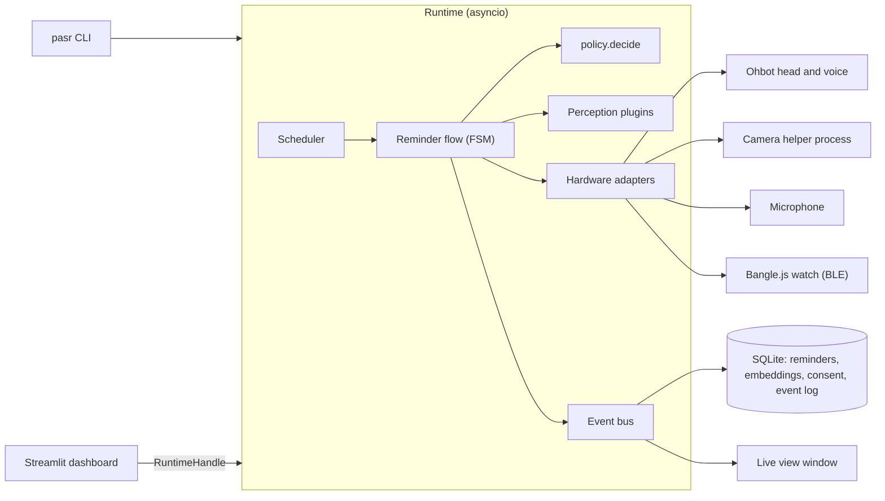

## In one paragraph

A plain-Python **Runtime** (asyncio) owns the hardware adapters, the perception plugins, the
scheduler and the reminder state machine. It publishes typed **events** to an in-process bus that
feeds the dashboard and a SQLite research log. The **CLI** (`pasr …`) and the **Streamlit
dashboard** both drive it. The dashboard keeps one runtime alive on a background thread
(`RuntimeHandle`); data-only commands write SQLite directly, and the running scheduler picks the
changes up by polling. Every device and every algorithm is a **Protocol**, and the product code
contains only real implementations. The tests swap in stand-ins (a scripted room, devices that act
on it, perception plugins and a virtual clock), so a 7-minute reminder flow runs in milliseconds
without the robot.

## Module map (`src/pasr/`)

| Package | Responsibility | Depends on |
|---|---|---|
| `domain/` | Pure logic: enums, models, identity matching, **disclosure policy**, timing, calibration maths, face framing. No I/O. | numpy |
| `settings/` | Settings schema with Basic and Advanced tiers; layered loading. | domain, perception.registry |
| `perception/` | Plugin registry and protocols; InsightFace, SpeechBrain ECAPA, Resemblyzer, Silero, faster-whisper and zero-shot plugins (lazy-loading); energy VAD, keyword and dateparser baselines; speech segmenter; model weights. | domain, settings.tiers |
| `hardware/` | Device protocols (head, speaker, camera, microphone, watch); adapters (Ohbot via one locked driver, macOS `say`, bleak BLE, OpenCV, sounddevice); WAV and image-folder sources; the Bangle wire protocol; discovery and checks. | domain |
| `storage/` | SQLite schema, migrations, repositories, reset. | domain |
| `live/` | The live view: an in-memory feed, and a window in its own process fed over a pipe. | domain |
| `orchestration/` | Clocks, event bus, FSM, scheduler, runtime lock, enrolment, calibration, `Runtime`, `RuntimeHandle`, notices. | everything above |
| `apps/` | Robot apps. `reminder/`: service, voice capture, **due flow**, scheduler-driven app, CLI. | orchestration |
| `dashboard/` | Streamlit pages and the schema-driven settings form. | everything |
| `cli.py` | The `pasr` command (typer). | everything |

## Concurrency

- **One asyncio loop per runtime.** In the dashboard it runs on the `pasr-runtime` thread;
  Streamlit scripts reach it only through `RuntimeHandle.call / call_sync / snapshot` and never
  share objects.
- **Blocking work off the loop.** ML inference goes through `RobotContext.compute`, a thread pool
  (inline with `Runtime(inline_compute=True)`, which keeps tests on a virtual clock
  deterministic). Hardware adapters call their blocking libraries with `asyncio.to_thread`.
- **One Ohbot driver per process.** The `ohbot` library is not thread-safe and has import-time
  side effects, so one `OhbotDriver` imports it (after switching to `.ohbot/`) and serialises
  every call with a lock shared by head and speaker.
- **Lazy models.** Plugins construct cheaply and load their model on first use under their own
  lock, so listing or configuring them never imports torch or onnxruntime.
- **The live view and the camera in their own processes.** macOS opens windows only on a main
  thread, and a camera that drops off USB stays dead in the process that had it open; a fresh
  helper process fixes both. ([ADR 0008](/decisions/0008-live-view),
  [ADR 0010](/decisions/0010-camera-helper-process))
- **Notices.** While the runtime runs, every warning and error it logs (and any error nothing
  caught on its loop) becomes an in-memory notice, shown once as a dashboard toast.
- **One runtime per data folder.** `data/.runtime.lock` (filelock) makes sure the robot, camera,
  microphone and watch have one owner and a reminder is never delivered twice.

## Storage

One SQLite database, `data/pasr.db`, with `secure_delete` on: the owner, owner and bystander
embeddings (float32 vectors tagged with their model), consent answers, reminders and the event
log. Settings changes go to `data/settings.json`. Model weights live in `models/`. All three are
git-ignored.

## Related topics

- [Reminder state machine](/reference/state-machine)
- [Extending PASR](/reference/extending): new algorithms, settings, devices, apps
- [Decision records](/decisions/index)
