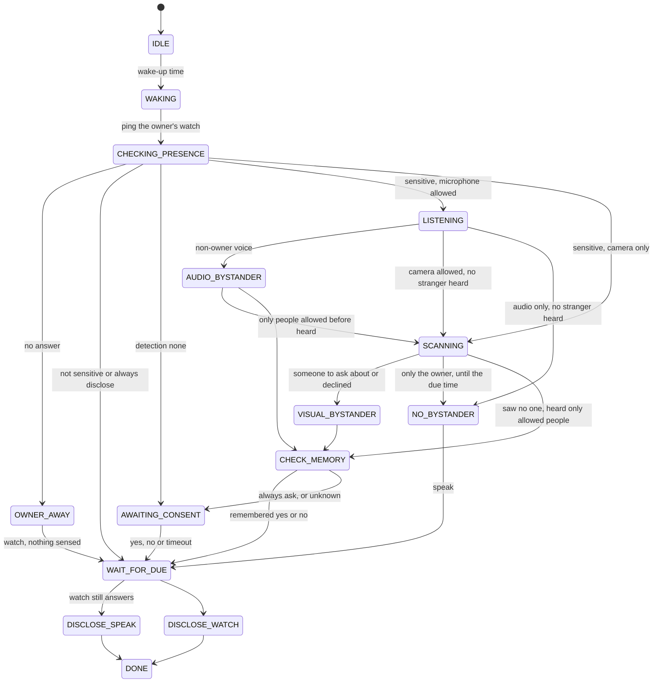

Any error, in any state, moves the flow to **`FAILED`** and the reminder goes to the watch (fail
closed). Decisions live in one pure function, `domain/policy.py:decide`, tested exhaustively.

## States

| State | What happens |
|---|---|
| `IDLE` | Waiting for the wake-up time: due − 7 min if sensitive and checked, − 2 min with the camera only, else the due time. |
| `WAKING` | The flow starts. |
| `CHECKING_PRESENCE` | Ping the owner's watch. No answer → `OWNER_AWAY`. |
| `OWNER_AWAY` | Nothing is sensed or said; deliver on the watch. |
| `LISTENING` | Listen for `listen_window_minutes`; identify each speech segment. |
| `SCANNING` | Sweep each row (level, up, down) right, front, left, each next row from the side where the head is, until the due time; look closer at a face that does not clearly match the owner (following it if on); note people allowed before and go on; stop once someone to ask about, or declined for, is recognised. |
| `AUDIO_BYSTANDER` · `VISUAL_BYSTANDER` | Someone other than the owner was heard or seen. |
| `NO_BYSTANDER` | Only the owner, or nobody. |
| `CHECK_MEMORY` | Under *ask once*, look up remembered answers for the people found. |
| `AWAITING_CONSENT` | The watch prompt is open (`consent.timeout_seconds`). |
| `WAIT_FOR_DUE` | The decision is made; wait for the due time. |
| `DISCLOSE_SPEAK` · `DISCLOSE_WATCH` | Say it out loud, or show it privately on the watch. |
| `DONE` · `FAILED` | Finished, or failed closed. |

## Rules worth knowing

**Owner presence first.** Every flow pings the watch (`Watch.ping`) before the microphone or
camera is used, and again right before speaking. ([ADR 0007](/decisions/0007-owner-presence-first))

**Owner heard, camera allowed.** With `reminder.scan_if_only_owner_heard` (on), the robot still
scans for silent bystanders after hearing only the owner.

**Following faces.** With `scan.follow.enabled`, a face that is not in full view and matches
nobody is followed until it is; if time runs out or it is lost, its best view is compared anyway.
([ADR 0009](/decisions/0009-follow-faces))

**Late start.** With less than `wake_lead_minutes` left when the flow wakes (a quick test, a
reminder added shortly before it is due, a robot started late), the robot listens for the first
70% of the time left with the microphone and camera, so the scan runs before the due time; with
the microphone only, it listens up to the due time. Either way at least `min_listen_seconds`.

**At the due time.** Reminders are delivered at the due time on both channels, never early.
([ADR 0004](/decisions/0004-deliver-at-due-time))

**One at a time.** Flows run one at a time. Interrupted flows (`active` in the database) are
re-scheduled when the robot starts.

## In the log

Every transition emits a `flow.state` event with `state_from`, `state_to` and a reason, for
example `CHECKING_PRESENCE → LISTENING` *sensitive reminder: listening for other voices*. The
dashboard's [Home](/dashboard/home) shows them as *Steps of this reminder*.
